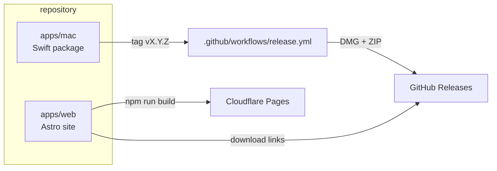
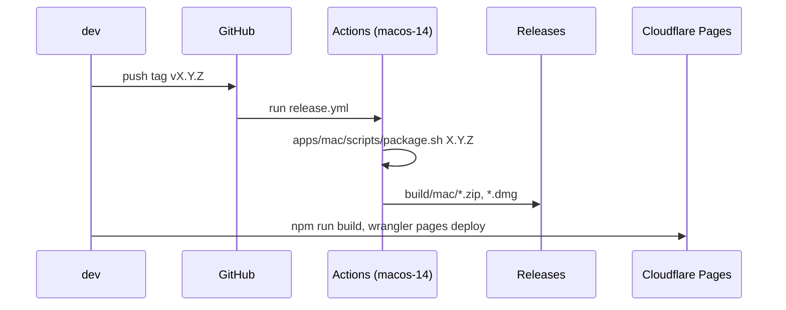

# Overview

Origami is a macOS menu bar app that folds several app windows into one group and draws a tab bar above them. This repository holds the app and its product site, side by side, with no shared source.

The only dependency between the apps is a naming convention: the site's download URLs must match the asset names that `apps/mac/scripts/package.sh` produces. Changing one means changing the other.

## apps/mac

A Swift Package Manager executable, macOS 13 or later, no third-party dependencies. It runs as an accessory app (`LSUIElement`), so it has a menu bar item and no Dock icon.

| file | responsibility |
|---|---|
| `Sources/Origami/main.swift` | creates `NSApplication` in accessory mode, installs `AppDelegate`, runs the loop |
| `AppDelegate.swift` | status bar item, the settings window (`MainView`), starts and stops the engine |
| `WindowOverlayManager.swift` | the engine: a timer-driven loop that watches windows, keeps overlays aligned, and switches groups |
| `GroupStore.swift` | which windows belong to which group, and which one is active |
| `TabBarView.swift` | the overlay tab bar, drawn by hand in an `NSView` |
| `AppSettings.swift` | every setting, stored in `UserDefaults` |
| `PermissionProbe.swift` | reads Accessibility and Input Monitoring state, with fix steps shown in settings |
| `MainView.swift`, `OverlayLabelView.swift`, `ShortcutRecorderView.swift`, `AutoGroupAppListEditor.swift` | SwiftUI settings UI |

How the loop works:

1. Every tick (60 Hz by default, adaptive down to 1 Hz when idle) it lists all windows with `CGWindowListCopyWindowInfo`, and keeps layer-0 windows that are on screen, large enough, not minimized, and not one of its own.
2. New windows are registered in `GroupStore`; windows that disappear are removed; optionally, a new window of an app that already has a group joins that group.
3. For each group it positions one borderless `NSPanel` at a computed offset from the active window's frame, and stacks it directly above that window with `order(.above, relativeTo:)`.
4. Switching tabs moves keyboard focus to the target window and hides the others using the configured hide mode.

Hide modes, and what each one needs:

| mode | mechanism |
|---|---|
| minimize | `kAXMinimizedAttribute` through the Accessibility API |
| transparent | private SkyLight `SLSSetWindowAlpha` / `CGSSetWindowAlpha` |
| move off screen | Accessibility position, outside every display |
| move to another Space | private SkyLight `SLSMoveWindowsToManagedSpace` |
| shrink | Accessibility size, restored on switch |

Three symbols are private and are resolved at runtime with `dlopen` and `dlsym`, so the app degrades instead of crashing when a macOS release removes them: `_AXUIElementGetWindow` (AX element to window number) and the SkyLight alpha, transform, and Spaces functions. Accessibility and Input Monitoring permission are requested from the settings window, not at launch.

Groups live only in memory. On launch and on quit the app restores every window it hid, and it can pull fully off-screen windows back with one click.

`scripts/package.sh <version>` builds a universal binary, assembles `Origami.app`, injects the version into `Resources/Info.plist`, generates the icon from `icon.png`, ad-hoc signs the bundle, and writes a `.zip` and a `.dmg` to `build/mac/` (`$WOK_OUT`). `Resources/Info.plist` keeps `VERSION_PLACEHOLDER` on purpose.

## apps/web

A static Astro site with Tailwind CSS, deployed to Cloudflare Pages. Chinese is the default language; `src/pages/en/index.astro` is the English page. All copy lives in `src/i18n/zh.ts` and `src/i18n/en.ts`, and both must stay in step.

Two components hold the released version as a literal: `GettingStarted.astro` and `ProductShowcase.astro` (`releaseVersion`). They build the DMG, ZIP, and release-page URLs from it, so they must be bumped together with a new tag. `MacOSDemo.astro` is a JavaScript re-creation of the tab bar, used as an interactive demo; it is independent of the app's code.

## Release pipeline

The workflow only publishes the macOS build. The site is deployed separately with Wrangler; its build settings are Root directory `apps/web`, build command `npm run build`, output `dist`. Steps for both are in `docs/guides/release.md`.
